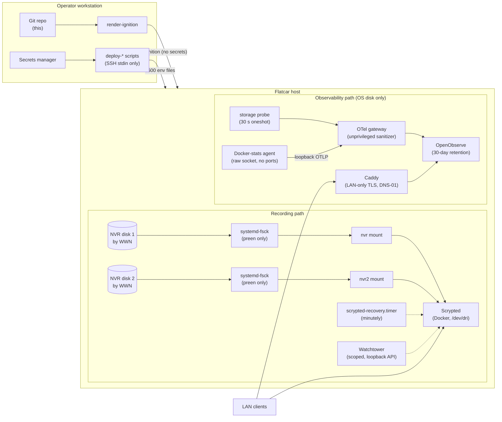

# Flatcar NVR with observability and recovery runbooks

A declarative, rebuildable home-lab network video recorder: [Scrypted](https://www.scrypted.app/) running in Docker on an immutable [Flatcar Container Linux](https://www.flatcar.org/) host, provisioned entirely from one Ignition file plus separately delivered secrets. It adds a privacy-filtered OpenObserve/OpenTelemetry monitoring stack and fail-closed storage recovery, so a flaky USB disk enclosure can't silently corrupt recordings.

All addresses, hostnames and disk IDs in this repository are examples (`10.10.10.0/24`, `example.com`, `home.arpa`, `wwn-0x5000000000000001`). See [Run it yourself](#run-it-yourself).

## Architecture



### Three biggest design calls

1. **Storage recovery fails closed.** On 2026-08-23 the USB bridge for both recording disks dropped out mid-write. Now each mount depends on systemd's native `systemd-fsck` for its stable WWN device, which applies only safe "preen" repairs. Scrypted starts only when both WWN paths exist, both mountpoint checks pass and no maintenance inhibit file is present. A minutely timer retries that start, so a returning enclosure recovers without anyone touching it, while damage that needs judgment leaves the recorder offline for a human. There is no unattended `e2fsck -y`, and a test enforces that.
2. **Secrets never enter Ignition or Git.** The recovered original Ignition config had a webhook token embedded in it. The rendered config now carries no runtime secrets. Secrets come from a secrets manager at deploy time, travel only over SSH stdin and land as root-owned `0600` env files. That keeps durable copies out of Git, out of provisioning media and out of shell history.
3. **Monitoring privilege is split.** Docker metrics need the Docker socket, which is root-equivalent. A generic "read-only" socket proxy still exposes logs, archives and process arguments. So the Docker-stats collector runs separately: it holds the raw socket but has no listening ports and no backend credentials, and forwards over loopback to an unprivileged gateway collector. That gateway is the only sanitizer and exporter, and it allowlists every metric and attribute. NVR capacity and I/O come from a short-lived sandboxed probe that reads only numeric `statfs`/sysfs counters, so no collector ever holds a recording mount open.

## How it runs

| Concern | Approach |
| --- | --- |
| Hosting | One repurposed x86-64 laptop on the home LAN (lid switch ignored, sleep targets masked). Flatcar on the internal disk, two recording disks in a USB enclosure, Intel iGPU passed to Scrypted for hardware decode. Static address, SSH key-only login. |
| Provisioning | `scripts/render-ignition` injects an SSH public key into `config/scrypted-nvr.ign.template.json` and embeds the observability configs. The output is written atomically and validated as JSON. |
| Deploy path | Host config: re-provision from Ignition. Observability: `verify-observability-live preflight` → `deploy-observability stage` → `start-bootstrap` → `start-stack`, each bound to a preflight receipt (target, source digest, protected baseline). Staging ships a checksummed manifest of only allowlisted, non-secret files and keeps transactional backups. `rollback-observability` restores them. |
| Updates | Flatcar auto-updates with a Sunday 03:00 reboot window. Scrypted follows upstream through a Watchtower instance scoped to its container. Observability images are pinned by digest and changed only by reviewed commits. |
| CI/CD | GitHub Actions runs the offline test suites on macOS (the operator platform). Deployment is deliberately manual and approval-gated; nothing deploys from CI. |
| Secrets | Bitwarden Secrets Manager → `scripts/deploy-secrets`, `deploy-observability-secrets {bootstrap,collector}`. Each credential group installs only its own file and restarts only its own units. |

## How you know it's healthy

- **Monitoring:** OpenObserve (local mode, 30-day retention) behind LAN-only Caddy TLS. *Homelab Foundation* dashboard: host CPU, load, memory and OS-disk pressure; NVR capacity and read I/O; LAN throughput; per-container CPU and memory; collector export health and OpenObserve ingestion. *AI Tool Usage* dashboard for metadata-only AI telemetry; real senders are a later milestone. Telemetry passes through bounded on-disk queues on a fixed 256 MiB filesystem, so a backlog drops data instead of filling the OS disk.
- **Logs:** journald is persistent and capped at 512 MB (64 MB files, 7-day rotation). Docker defaults to the journald log driver.
- **Liveness and self-healing:** `Restart=always` on Scrypted and Watchtower and `Restart=on-failure` on the observability units, plus the minutely recovery timer for the storage-loss case where `Restart=` doesn't apply. `verify-observability-live postflight` checks exact units, containers, resource caps, the listener set and certificate expiry, and reports bounded metadata only.
- **Alerts:** none for the NVR yet. This is a known gap; today it's dashboards only.
- **Backups:** the host and the observability stack can be rebuilt from Git plus the secrets manager. Recordings and the Scrypted state volume (`/var/lib/scrypted/volume`) are **not** backed up yet. Documenting that backup and restore is on the roadmap.

### One thing that broke, and the fix

On 2026-08-23 the USB-SATA bridge disconnected for six seconds. Both disks returned write errors and their ext4 journals aborted. They came back under new kernel names (`sdb/sdc` → `sdd/sde`). systemd stopped Scrypted through its mount dependencies, and `Restart=always` doesn't fire after a systemd-initiated stop, so the recorder stayed down. A one-shot udev hook would have lost the race too: the devices reappeared 53 seconds *before* the stop transaction finished.

Recovery that night was manual (approved `e2fsck -f -y`, then forced read-only re-checks). The durable fix is design call 1: device names pinned by WWN, native fsck preen as a mount dependency, presence conditions, a maintenance inhibit file and a minutely retry timer. `tests/storage-hotplug-recovery.sh` locks in that contract.

## How it was built

Nearly all of the code, tests and docs were written by AI coding agents (OpenAI Codex and Claude Code) working under my direction. I set the requirements and safety invariants (for example: never fsck `-y` unattended; never bind a recording mount into a collector; no public exposure). I approved every gate that touched the live host and verified live changes myself.

How the output was checked:

- **Cross-model adversarial review.** Material changes were reviewed read-only by a different model family from the one that wrote them. Each finding was verified against the source before it was adopted or rejected.
- **Hermetic tests.** The shell suites stub `ssh`, `docker`, `systemctl`, `ss` and friends to exercise deploy, stage, rollback and postflight logic, including fault injection and crash-safe rollback. Static tests pin collector configs, unit files and image digests, and `tests/fixtures/observability-render-baseline.json` pins the rendered Ignition.
- **Runtime and live gates.** `observability-config-runtime.sh` runs the pinned Collector in a disposable Docker runtime and checks exact sanitization with canary values. `observability-privacy-live.sh` checks the deployed endpoint using synthetic fixtures only. Live steps require a preflight receipt and explicit approval.

## Run it yourself

Requirements: macOS (the tooling uses BSD `stat`, `tar` and `date`), `sh`, `jq`, `python3`, Homebrew GNU tar (`brew install gnu-tar`; one hermetic test needs it), an SSH key, and a Flatcar-capable x86-64 machine.

1. **Set your site values.** Find every example value and replace it with your own: host address/prefix, gateway, DNS, search domain, observability hostname, the two `/dev/disk/by-id` names and the timezone. The tests assert these values too, so update them in the same change. Some values appear in encoded forms: percent-encoded in Ignition `data:` URLs (`/` → `%2F`) and systemd-escaped in fsck unit names (`-` → `\x2d`). The search below matches both forms; keep each encoding when you substitute.

   ```sh
   git grep -nE '10\.10\.10\.|example\.com|home\.arpa|500000000000000[12]|Etc(/|%2F)UTC'
   ```

2. **Run the tests.**

   ```sh
   sh -ec 'for t in tests/*.sh; do case $t in *config-runtime*|*privacy-live*|*operations-hermetic*) continue;; esac; sh "$t"; done'
   ```

3. **Render and provision.** Boot Flatcar with the output (USB installer, PXE or `flatcar-install -i`).

   ```sh
   scripts/render-ignition ~/.ssh/id_ed25519.pub build/scrypted-nvr.ign
   ```

4. **Deliver secrets** once SSH is reachable. Set `WATCHTOWER_HTTP_API_TOKEN` and `SCRYPTED_WEBHOOK_UPDATE_AUTHORIZATION` in the environment; the scripts' usage text assumes a Bitwarden Secrets Manager wrapper (`bws-project run --`), but any injector that sets those variables works.

   ```sh
   scripts/deploy-secrets core@10.10.10.50
   ```

5. **Optional: observability.** Follow the receipt-gated sequence in [How it runs](#how-it-runs). Dashboard provisioning (`provision-observability-dashboards`) refuses to run except under the `bws-project run --` wrapper.

## Runbooks

**Planned recording-storage maintenance.** Never unplug or power-cycle mounted disks.

```sh
sudo touch /etc/scrypted/disable-auto-recovery
sudo systemctl stop scrypted.service
# unmount, perform maintenance, restore both disks
sudo rm /etc/scrypted/disable-auto-recovery
sudo systemctl start scrypted.service   # optional; the timer retries within a minute
```

**Filesystem needs more than a preen.** fsck fails, so the mount and Scrypted stay down. Run `e2fsck` by hand on the unmounted WWN device, re-check read-only, then start `scrypted.service`.

**Observability rollback.** `scripts/rollback-observability core@<host> <receipt>` stops only observability units and restores only receipt-bound files, preserving OpenObserve data and all Scrypted/NVR state. Follow it with `verify-observability-live postflight`.

**Secret rotation.** Re-run the matching `deploy-*secrets` mode. Each mode replaces only its own `0600` file and restarts only its own units.

## Repository layout

```text
config/scrypted-nvr.ign.template.json   Ignition template (host, mounts, Scrypted, recovery timer)
config/observability/                   OpenObserve, Caddy, OTel configs, units, storage probe, dashboards
scripts/                                Render, secret delivery, observability stage/start/verify/rollback
tests/                                  Hermetic, static and runtime test suites
.github/workflows/ci.yml                CI
```

## License and status

- **License:** [MIT](LICENSE).
- **Status:** in daily use on my home network. Still open: a controlled enclosure power-cycle acceptance test of the recovery path, a disposable-VM test of a freshly rendered Ignition config, NVR alerting, and Scrypted volume backups.
